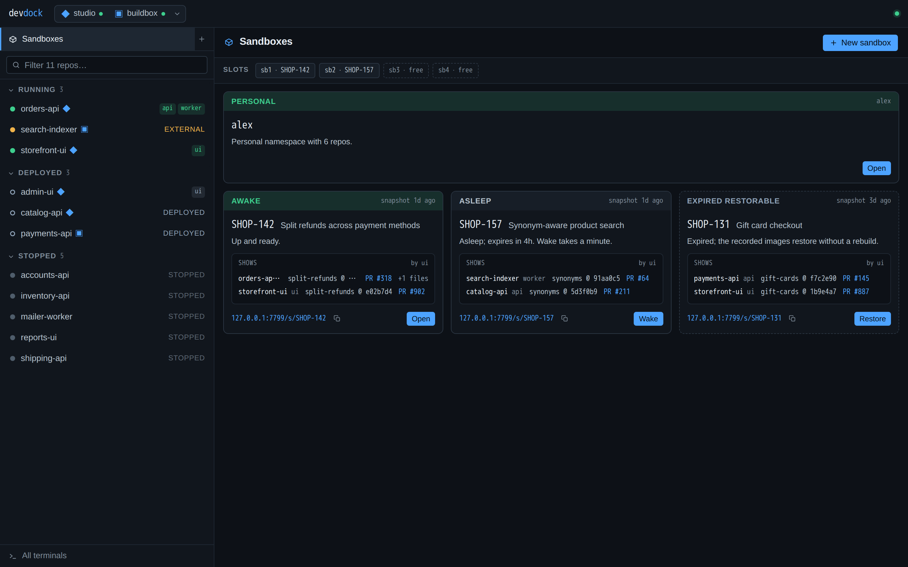

# devdock

A global control plane for [DevSpace](https://www.devspace.sh/) sessions — **start, kill, build, and attach** to dev pods across every repo on your machine, from one always-on daemon.

Built for two users sharing the same brain: a human at a menu bar, and an AI agent over MCP.

[](docs/demo/demo.mp4)

The recording is the real web dashboard served by a demo daemon with fictional repos, machines and sandboxes ([mp4](docs/demo/demo.mp4), [webm](docs/demo/demo.webm)). No cluster is involved.

## The problem

Working with DevSpace means walking each repo by hand: `cd` in, run `devspace dev`, leave a terminal hostage to its foreground sync, repeat for every service — and remember to `devspace purge` when you're done (you don't). Idle syncs quietly eat your laptop.

devdock makes that a single pane of control. It's not a Kubernetes IDE and not a DevSpace replacement — it's a thin, opinionated orchestrator *over* the tools you already trust (`devspace`, `kubectl`, `tmux`), exposing them through one consistent surface.

## The verbs

| Action | Underlying command | Meaning |
| --- | --- | --- |
| **Start** | `devspace dev` | Build + deploy + file-sync + port-forward + in-pod dev terminal |
| **Build** | `devspace deploy` | Build & deploy the workload without entering dev mode |
| **Kill** | `devspace purge` | Tear the deployment down; free cluster *and* local sync resources |
| **Listen** | `tmux attach -r` / `kubectl logs -f` | Read-only view of the running process and its crashes |
| **Attach** | `tmux attach` / `kubectl exec -it` | Read-write terminal: run `python main.py`, poke around, restart |

## How it works

Three thin layers over `devspace` + `kubectl` + `tmux`:

- **Clients** — a menu-bar GUI + web view (you: glance + click), an MCP server (agent: call + read), and a CLI. All call the *same* core service layer.
- **Control daemon** — the only brain. Headless, always-on (launchd). Scans `~/Code/**/.devspace/*/devspace.yaml`, reconciles desired vs. actual cluster state, supervises subprocesses, brokers PTYs and log tails over websockets, watches for crashes, and persists state in a JSON file under `~/.devdock`.
- **Execution** — each `devspace dev` runs inside its own named `tmux` session (`devdock-<repo>`), so it survives daemon restarts and the daemon never blocks on it.

### Two key design decisions

- **tmux owns the process.** Launching `devspace dev` inside a named tmux session means dev mode outlives the daemon, gives read-only (`-r`) vs read-write attach for free, and feeds a web terminal via node-pty → xterm.js without ttyd.
- **State comes from the cluster.** devdock never trusts its own memory — on boot and on a timer it reconciles against live `kubectl` output, so it's crash-proof and can adopt pods it never started (`RUNNING`, `CRASHED`, `STOPPED`, managed vs. external).

### One brain, two doors

The core service layer has **zero transport knowledge**. The human GUI and the agent's MCP verbs are two doors into one room, so they never drift. The read-only vs read-write terminal distinction you want for yourself *is* the permission scope for the agent: a read-only token can observe and diagnose; a read-write token can restart and run.

## Stack

TypeScript end-to-end in a pnpm workspace: a Fastify daemon (HTTP and WebSocket), node-pty to xterm.js for terminals, a Svelte 5 dashboard, a Tauri menu-bar tray, an MCP server for agents, and a JSON state file. It drives `devspace`, `kubectl`, `helm` and `tmux`.

## Setup

Needs Node 20+, pnpm, and `devspace`, `kubectl` and `tmux` on the PATH with a working kube context.

```sh
pnpm install
pnpm build
pnpm dev                                   # daemon on http://127.0.0.1:7717, serves the dashboard
packages/daemon/launchd/install.sh         # or packages/daemon/systemd/install.sh, always-on
```

The daemon scans `DEVDOCK_ROOTS` (default `~/Code`) for `.devspace/*/devspace.yaml`.

## Demo

`packages/daemon/demo/fixtureDaemon.ts` serves the built dashboard and answers its API with fictional state. Sandbox ribbons and lifecycle buttons come from the same core functions the real daemon uses. Wake, sleep and restore run scripted progress instead of touching a cluster.

```sh
pnpm install && pnpm --filter @devdock/web build
pnpm --filter @devdock/daemon exec tsx demo/fixtureDaemon.ts    # http://127.0.0.1:7799
```

To record `docs/demo/poster.png`, `demo.webm` and `demo.mp4` again (Playwright and an ffmpeg with libvpx-vp9 and libx264):

```sh
PLAYWRIGHT=/path/to/node_modules/playwright FFMPEG=ffmpeg node docs/demo/capture.mjs
```

## Status

In daily use on my own machines. There is no packaged release; it installs from a checkout. Ticket sandboxes run as slots inside one personal namespace. [`devdock.html`](devdock.html) is the original architecture spec and [`docs/sandboxes.html`](docs/sandboxes.html) covers sandboxes.

## Restricted development connection

Outgoing instance links do not create a return tunnel. A workstation can open
remote terminals without exposing its own terminal service to the remote host.

Set `DEVDOCK_AGENT_SOCKET` on the daemon to expose repository and pod operations
through a separate Unix socket. Its parent must be daemon-owned, setgid, and have
no group write or other access, for example mode `2750`. The socket uses `0660`,
so membership in its group grants development access. Host terminals, credential
routes, and instance routing are rejected by this listener.

Development clients use `DEVDOCK_SOCKET` pointing to that socket and
`DEVDOCK_MCP_DEVELOPMENT_ONLY=1` to omit unavailable host and instance tools.

## MCP endpoints

The daemon serves MCP over Streamable HTTP on its own listener, both protocol
eras (2025 `initialize` and 2026-07-28): `http://127.0.0.1:7717/mcp` is
read-only and `/mcp/rw` adds the write verbs. Every agent session shares the
warm daemon instead of spawning a process, and requests pass the same ingress
gate as the rest of the API. The agent socket does not serve MCP.

`devdock-mcp` still speaks stdio for clients that cannot use HTTP; it proxies
to the daemon API and reads `DEVDOCK_MCP_SCOPE=rw` for write verbs.
